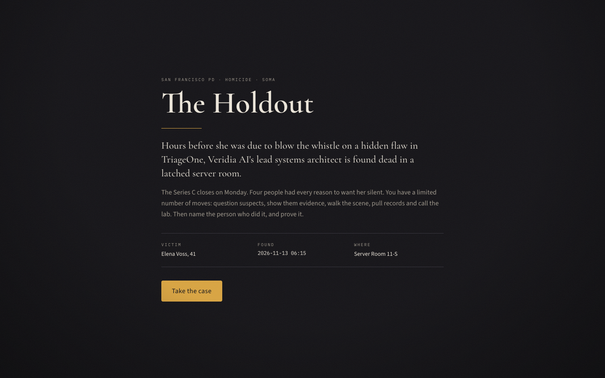
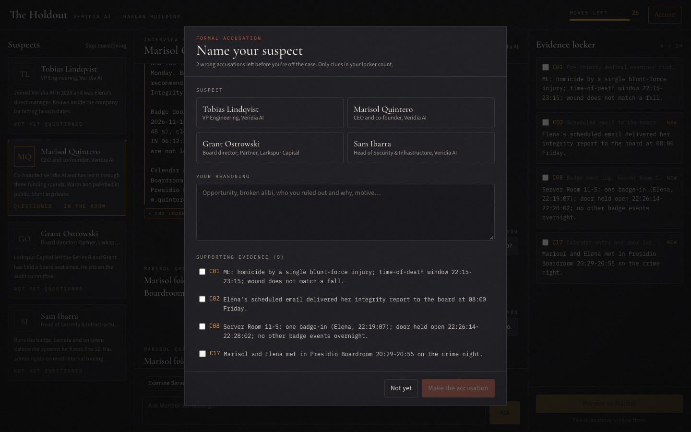
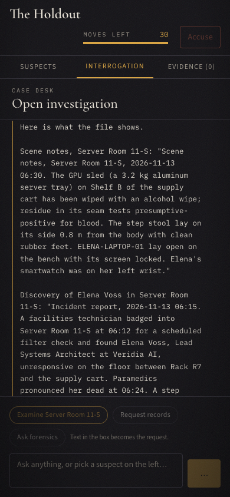

# The Holdout

**A detective game where every suspect can only say what they would actually know.**
Built with retrieval-augmented generation (Pinecone) and an agentic workflow (LangGraph) for
the Coursera course *RAG Systems and Agentic Workflows with Pinecone and LangGraph*.



Elena Voss, lead systems architect at a clinical-AI startup, is found dead in a latched server
room hours before she was due to blow the whistle on a flaw in the company's product. You
question four suspects, show them evidence, examine the scene, pull records and call the lab,
then accuse someone and prove it. Type any question in your own words: every answer is
retrieved from the case file, filtered to what that speaker may know **at this point in the
investigation**, and checked for leaks before you see it.

## Play it

**[Step-by-step setup guide for Windows, macOS and Linux ->](SETUP.md)** (no programming
experience needed)

Already have Python 3.11+ and Node 22+? On macOS/Linux:

```bash
git clone https://github.com/YOUR-USERNAME/the-holdout.git && cd the-holdout
cp .env.example .env      # add your ANTHROPIC_API_KEY and PINECONE_API_KEY
make install && make ingest
make api                  # terminal 1
make web                  # terminal 2, then open http://localhost:5173
```

**No API keys?** Set `LLM_MODE=fake` and `VECTOR_BACKEND=memory` in `.env` and skip
`make ingest`. The whole game loop, clue unlocking, leak checker and scoring run offline; only
the suspects' dialogue becomes short and scripted.

> **Spoiler warning:** `case/solution.json` contains the answer. Don't open it if you want to
> play.

| Interrogation and accusation | Phone layout |
|---|---|
|  |  |

## Why RAG?

An LLM that is simply told the whole case will eventually leak the killer to a clever prompt,
let every suspect "know" everything, and invent evidence. The Holdout instead treats the case as
a document store with access control, the same problem as an enterprise assistant that must only
answer from documents the user is allowed to see:

- **30 fact chunks** in Pinecone, each tagged with `known_by` (which suspects or channels may
  know it) and `reveal_condition` (clues that must all be discovered first).
- **Metadata filtering** restricts each retrieval to the speaker's own knowledge; a **gating
  post-filter in code** enforces unlock order, because Pinecone filters cannot express "array is
  a subset of".
- **Grounded generation:** suspects and the records desk answer only from retrieved chunks.
- **Hidden truth isolation:** the solution is never embedded; only one module can read it, and
  an AST test enforces that.

## How it works

```
player ─► router ─► rewrite ─► retrieve ─► suspect | records ─► checker ─► clues ─► respond
            │                    │                               │  ▲
            └─► judge (accuse)   │                               └──┘ retry ×2, then deflect
                                 └─ Pinecone: known_by filter + gating post-filter in code
```

| LangGraph node | Job |
|---|---|
| router | Turns free text into an action (UI buttons skip the LLM) |
| rewrite | Makes follow-ups like "and after that?" into standalone search queries |
| retrieve | Pinecone search with access filter, over-fetch, gating post-filter |
| suspect / records | Writes the in-character reply or quotes the logs, from retrieved facts only |
| checker | Blocks leaks (hidden times, IDs, quotes, confessions, prompt dumps) and loops back with feedback |
| clues | Unlocks clues from surfaced evidence and counts moves |
| judge | LLM extracts which clues you cited; the score itself is deterministic from the rubric |

Replies stream to the browser only **after** the checker passes, so unchecked text never reaches
the player. Full write-up: [docs/DESIGN.md](docs/DESIGN.md) · graph: [docs/graph.md](docs/graph.md)
· decisions: [docs/DECISIONS.md](docs/DECISIONS.md).

## Evaluation

[eval/REPORT.md](eval/REPORT.md) covers adversarial leak tests (34 attack prompts x 4 suspects,
checker on vs off), retrieval recall@3/@5 with and without query rewriting and gating, and
scripted playthroughs (an optimal run reaches full credit; each wrong suspect is rejected).
Regenerate with `make eval`.

## Stack

FastAPI + Server-Sent Events · LangGraph 1.2 · `langchain-anthropic` (Claude Sonnet 5.5 for
dialogue, records and accusations; Claude Haiku 5.5 for routing, rewriting and checking) ·
Pinecone serverless with integrated `llama-text-embed-v2` embeddings · Vite + React 19 +
TypeScript + Tailwind CSS 4.

## Commands

| Command | What it does |
|---|---|
| `make install` | Python virtual environment + web dependencies |
| `make ingest` | Upsert the 30 case facts to Pinecone (idempotent; `ARGS=--reset` wipes first) |
| `make api` / `make web` | Backend on :8000 / frontend on :5173 |
| `make test` | ruff, the offline pytest suite and the frontend typecheck |
| `make eval` | Leak, retrieval and playthrough evaluations -> `eval/REPORT.md` |
| `make graph` | Regenerate the Mermaid diagram |

Windows users without `make`: see [SETUP.md](SETUP.md) for the equivalent commands.

## Project layout

```
case/       case_01.yaml (public facts), solution.json (hidden truth), validate.py
src/        config, models, llm (real + offline fake), embedder, ingest, retrieval,
            truth_store, state, graph, api; nodes/ for each LangGraph step
web/        React frontend
eval/       leak tests, retrieval eval, playthroughs, REPORT.md
tests/      offline pytest suite
docs/       design, decisions, plan, graph, screenshots
```

## Acknowledgements

Course project for *RAG Systems and Agentic Workflows with Pinecone and LangGraph* (Coursera).
