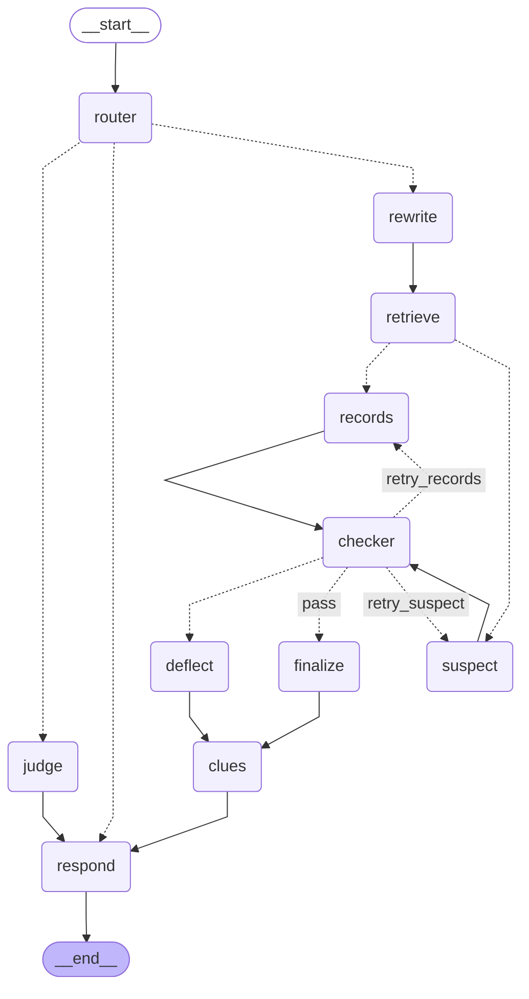

# Game graph

Generated by `make graph` from `src/graph.py`. Dotted edges are conditional.

| Node | Role |
|---|---|
| `router` | Classifies free text into an action (fast model); UI actions skip the LLM. Invalid input, out-of-turns and closed cases go straight to `respond`. |
| `rewrite` | Builds a standalone query (fast model) and the access filter (in code). |
| `retrieve` | Pinecone query with `known_by` filter, top_k=20, gating post-filter, top 5. |
| `suspect` | In-character reply (main model) from own chunks + private brief. |
| `records` | Scene / records / forensics answer quoting retrieved chunks (main model). |
| `checker` | Gate guard + statement guard + LLM review (fast model). Fail loops back with feedback, at most 2 retries. |
| `deflect` | Safe in-character deflection after the retries are used up. |
| `finalize` | Promotes the checked draft to `final_reply`. |
| `clues` | Unlocks clues from surfaced channel chunks; decrements turns. |
| `judge` | Extracts cited clues (main model) and scores deterministically from the rubric. |
| `respond` | Appends the turn to the conversation history (checked text only). |
